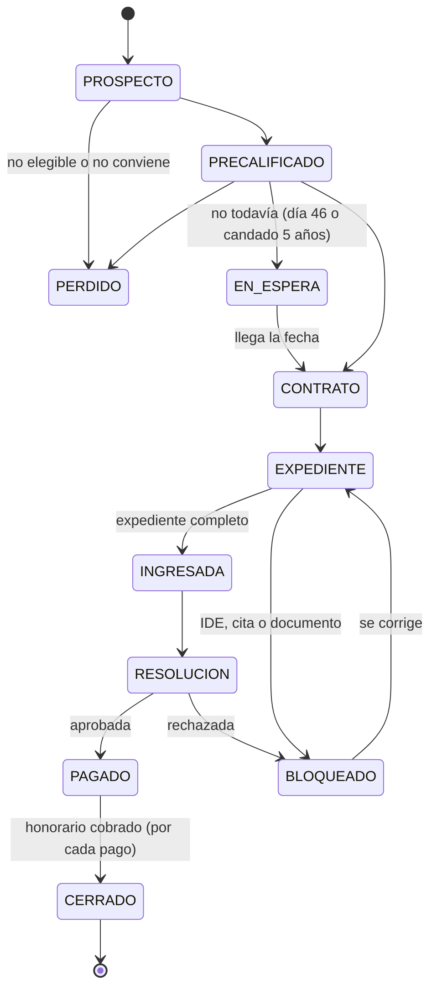

# Sistema de Control de Clientes — RetiroPorDesempleo.com

Oct 27, 2026 · @Irving  Ortega Valois

## 1. Resumen ejecutivo

El sistema es un CRM operativo interno para llevar cada prospecto y cliente de RetiroPorDesempleo.com desde el primer contacto hasta el cobro del honorario y el pago de comisiones. Su función central es calcular solo las fechas que la ley y el contrato imponen (día 46, candado de 5 años, 15 días hábiles, 90 días de vigencia) y avisar a tiempo.

**Nombre de trabajo:** RPD Control (panel interno, no visible al cliente en la fase 1).

**Qué resuelve:**

- Un solo registro por persona, con uno o varios **casos** (retiro por desempleo, pensión Ley 73, Ley 97, Modalidad 40, fallecimiento, devolución Infonavit, corrección de NSS).
- Calcula la **fecha en que el cliente ya puede retirar** (día 46 natural desde la baja) y avisa antes y el mismo día.
- Precalifica con las reglas ya acordadas de la calculadora (modalidad A/B, tope 10 UMA, 11.5% del RCV, semanas que se pierden por el art. 198).
- Controla el expediente documento por documento, con vencimientos (comprobante de domicilio de 3 meses, estado de cuenta de 2 meses).
- Registra lo que paga la Afore (una exhibición o hasta 6 mensualidades), calcula el honorario del 30% con IVA incluido y las comisiones de vendedor, referidor y socio.
- Da un tablero con lo urgente de hoy, el embudo y el dinero por cobrar.

**Fuera de alcance (fase 1):** presentar trámites en AforeWeb por el cliente, guardar contraseñas de portales de terceros, facturación CFDI automática y asesoría legal. El sistema registra y avisa; la gestión ante la Afore la sigue haciendo el asesor con el cliente.

**Cómo usar este documento con Claude Code:** expórtalo a Markdown y guárdalo en la raíz del repositorio como `docs/ESPECIFICACION.md`. Luego crea un `CLAUDE.md` con el texto de la sección 13 y pide cada fase por separado. Las reglas de negocio (secciones 2, 7 y 9) son la fuente de verdad: si el código y este documento no coinciden, manda el documento.

## 2. Reglas de negocio

Estas reglas se programan como **configuración editable** (tabla `parametros`), nunca escritas a mano dentro del código: los porcentajes, la UMA y los plazos cambian.

### 2.1 Servicios (catálogo `tipos_servicio`)

| Clave | Servicio | Cómo se cobra | Notas de política |
| --- | --- | --- | --- |
| `RETIRO_DESEMPLEO` | Retiro parcial por desempleo (art. 191-II LSS) | 30% de lo que paga la Afore, **IVA incluido** | Preferente para Ley 97 o cuando no afecta la pensión. Sin monto mínimo de retiro |
| `PENSION_L73` | Asesoría de pensión Ley 73 (cesantía, vejez, invalidez) | Honorario fijo capturado por caso | Línea prioritaria del negocio |
| `PENSION_L97` | Asesoría de pensión Ley 97 | Honorario fijo |  |
| `MODALIDAD_40` | Continuación voluntaria (arts. 218-221) | Honorario fijo | Requiere seguimiento mensual de pagos |
| `PTI_M10` | Incorporación voluntaria / independiente | Honorario fijo | Ventana de 12 meses del art. 85 RACERF |
| `FALLECIMIENTO` | Pensión de viudez/orfandad y recuperación de saldos | Honorario fijo + % de lo recuperado (configurable) | Esquema de comisión especial (sección 9) |
| `DEVOLUCION_INFONAVIT` | Devolución de subcuenta de vivienda (DSSV) | Honorario fijo o % (configurable) | Trámite gratuito ante Infonavit: se vende la revisión y corrección |
| `CORRECCION_NSS` | Unificación de NSS / corrección de semanas | Honorario fijo |  |

El catálogo es una tabla: agregar un servicio no requiere programar.

### 2.2 Honorario del retiro (30% IVA incluido)

El honorario se calcula sobre cada pago que la Afore hace al cliente, no sobre el estimado.

```latex
honorario\_total = monto\_pagado\_por\_afore \times 0.30
```

```latex
subtotal = honorario\_total \div 1.16 \qquad iva = honorario\_total - subtotal
```

Ejemplo: la Afore deposita $10,000 → honorario $3,000 → subtotal $2,586.21 + IVA $413.79. Redondeo a 2 decimales en el subtotal; el IVA es la diferencia, para que siempre sume exacto.

### 2.3 Requisitos legales del retiro (art. 191-II LSS)

| Requisito | Regla para el sistema | Bloquea el caso |
| --- | --- | --- |
| Día 46 natural | `fecha_elegible = fecha_baja + 46 días naturales` (criterio conservador, configurable) | Sí, hasta la fecha |
| Sin retiros en 5 años | `fecha_candado = fecha_ultimo_retiro + 5 años`. Si no hay estado de cuenta de la Afore, el campo queda "por verificar" | Sí, si la fecha es futura o está por verificar |
| Modalidad A | Cuenta con 3+ años de abierta **y** 12+ bimestres cotizados | Define monto |
| Modalidad B | Cuenta con 5+ años de abierta | Define monto |
| IDE actualizado | Booleano con fecha de verificación | Sí: sin biometría el portal no avanza |
| Cuenta bancaria nivel 4 | Campo de validación; advertir si es Nu, Mercado Pago u otra cuenta solo digital | Advertencia |
| Cuenta registrada en Afore | No "asignada" | Sí |

### 2.4 Plazos de servicio

- **15 días hábiles** (compromiso de la firma, máximo legal) contados desde que el expediente queda **completo**.
- **5 días hábiles** de resolución de la Afore, contados desde el acuse.
- **90 días naturales** de vigencia del contrato, con **suspensión** del conteo mientras falten documentos atribuibles al cliente.
- Días hábiles = lunes a viernes, menos los días inhábiles cargados en la tabla `dias_inhabiles` (feriados oficiales y los que defina la Afore).

### 2.5 Reglas de política que el sistema hace cumplir

- **Ley 73 + retiro:** el caso no avanza a "Contrato firmado" sin un **análisis de impacto** registrado (semanas antes y después, efecto en incrementos del art. 167 o en el umbral de 500 semanas) y la casilla "el cliente recibió y entendió el costo en semanas".
- **Ley 97 cerca del umbral:** si las semanas después del retiro quedan por debajo del mínimo del año de pensión (875 en 2026, +25 por año hasta 1,000 en 2031), alerta crítica.
- **Nunca se promete un monto:** todos los cálculos se muestran como "estimado" hasta que la Afore paga.
- **Transparencia en semanas:** el reporte al cliente siempre muestra lo que recibe y las semanas que pierde, lado a lado.
- **Prohibido** registrar alteraciones de salario o patrones ficticios: el sistema no tiene campos para eso y la bitácora registra quién cambia SBC o semanas.

### 2.6 Folios

Cada caso recibe un folio único consecutivo `RP-0001`, `RP-0002`… que también es el número de contrato. El prefijo y el ancho son parámetros. Una persona con dos casos tiene dos folios.

## 3. Usuarios, roles y permisos

Cinco roles cubren la operación actual y el esquema de socios. Cada usuario ve solo lo que su rol permite, y el control se aplica en la base de datos (Row Level Security), no solo en la pantalla.

| Rol | Quién | Ve | Puede editar | No puede |
| --- | --- | --- | --- | --- |
| Director | Irving | Todo | Todo, incluidos parámetros, esquemas de comisión y usuarios | — |
| Asesor | Asesor de trámite | Todos los casos asignados y la bandeja general | Personas, casos, expediente, fechas, pagos de Afore | Parámetros, comisiones de otros, borrar registros |
| Vendedor | Juan Carvajal y futuros vendedores | Solo sus prospectos y casos; datos sensibles enmascarados (NSS `•••••••1002`, CURP parcial, sin CLABE) | Alta de prospectos, notas, seguimiento, precalificación | Expediente completo, pagos, honorarios ajenos |
| Socio licenciatario | Socio bajo licencia de marca | Solo los casos de su cartera y su estado de cuenta de reparto | Igual que asesor sobre sus casos | Ver cartera de otros socios |
| Referidor | Persona externa que manda clientes | Nada en fase 1 (se registra como contacto, sin acceso) | — | — |

**Reglas de acceso transversales:**

- Todo registro tiene `owner_id` (quién lo trae) y `asignado_a` (quién lo opera); pueden ser distintos.
- Ver un dato sensible completo (NSS, CURP, CLABE, documentos) deja un renglón en la bitácora.
- Nadie borra: los registros se **archivan** con motivo. Solo el Director puede eliminar físicamente, y solo para atender una solicitud ARCO de cancelación.

## 4. Arquitectura y stack recomendado

La recomendación es una aplicación web Next.js con PostgreSQL en Supabase: da base de datos, autenticación, almacenamiento privado de documentos y tareas programadas en un solo servicio, y Claude Code la domina bien.

| Capa | Tecnología | Por qué |
| --- | --- | --- |
| Front + back | **Next.js 15** (App Router, Server Actions) + **TypeScript** estricto | Un solo proyecto, tipado de punta a punta |
| UI | **Tailwind CSS** + **shadcn/ui** + **lucide-react** | Componentes profesionales que se adaptan a la marca (sección 11) |
| Tablas y formularios | **TanStack Table**, **React Hook Form** + **Zod** | Filtros, orden y validación compartida entre front y servidor |
| Base de datos | **PostgreSQL** (Supabase) con **Prisma** o **Drizzle** como ORM | Relacional, con RLS para permisos por rol |
| Autenticación | Supabase Auth con correo + contraseña y **2FA obligatorio** | Datos personales sensibles |
| Documentos | Supabase Storage, bucket **privado**, URLs firmadas de 10 minutos | El expediente nunca queda público |
| Tareas programadas | `pg_cron` o Supabase Edge Function diaria a las 07:00 (America/Mexico\_City) | Genera alertas y vencimientos |
| Correo | **Resend** desde `alertas@retiropordesempleo.com` | Resumen diario y avisos |
| WhatsApp | Fase 1: botón *click-to-chat* con mensaje prellenado. Fase 4: WhatsApp Business API | Arrancar sin costo ni aprobación de Meta |
| Calendario | Exportar `.ics` por caso; fase 4: Google Calendar | Las fechas clave aparecen en el calendario de Irving |
| Gráficas | **Recharts** | Tablero |
| Fechas | **date-fns** + `date-fns-tz` | Días hábiles y zona horaria de México |
| Pruebas | **Vitest** (reglas) + **Playwright** (flujos) | El motor de reglas se prueba con casos reales |
| Hosting | Vercel (front) + Supabase (datos) | Despliegue en un clic. Alternativa: Node.js en Hostinger con la misma base Supabase |

**Decisión clave de arquitectura:** todas las reglas (fechas, montos, comisiones) viven en un módulo puro `lib/reglas/` sin dependencias de base de datos ni de interfaz. Así se prueban solas, se reutilizan en el formulario web de precalificación y en la calculadora, y no se duplican.

**Integración con el sitio:** el formulario de precalificación del sitio (el que inicia con "retiro por desempleo" o "pensión Ley 73") envía un `POST` firmado a `/api/leads`, que crea el prospecto con origen `web` y dispara la alerta de "prospecto nuevo".

## 5. Modelo de datos

La unidad de trabajo es el **caso**, no la persona: una persona puede tener un retiro hoy y una pensión dentro de tres años, cada uno con su folio, su embudo y sus cobros. Todas las tablas llevan `id` (UUID), `created_at`, `updated_at`, `created_by` y `archivado_at`.

**Relaciones:** `personas` 1─N `casos` · `casos` 1─1 `datos_imss` · `casos` 1─1 `datos_afore` · `casos` 1─N `calculos`, `documentos`, `eventos`, `alertas`, `pagos_afore`, `cobros`, `comisiones`, `pagos_m40` · `pagos_afore` 1─N `cobros` · `usuarios` / `referidores` / `socios` 1─N `comisiones`.

### 5.1 `personas`

| Campo | Tipo | Notas |
| --- | --- | --- |
| `nombre`, `apellido_paterno`, `apellido_materno` | texto | Obligatorios para cliente; para prospecto basta nombre + teléfono |
| `curp` | texto cifrado | Valida formato de 18 caracteres; de aquí se deriva fecha de nacimiento y sexo |
| `nss` | texto cifrado | 11 dígitos con dígito verificador (algoritmo Luhn modificado) |
| `rfc` | texto | Opcional |
| `fecha_nacimiento` | fecha | Calcula edad y fechas de 60 y 65 años |
| `telefono`, `whatsapp`, `email` | texto | WhatsApp en formato E.164 (`+52…`) |
| `municipio`, `estado` | texto | Para reportes por zona |
| `estado_civil` | enum | Relevante en pensiones y fallecimiento |
| `origen` | enum | `web`, `whatsapp`, `llamada`, `referido`, `vendedor`, `facebook`, `google`, `otro` |
| `referidor_id` | FK | Si llegó por un referidor |
| `owner_id` | FK usuarios | Quién la trajo |
| `privacidad_aceptada_at`, `privacidad_version` | fecha, texto | Consentimiento del aviso de privacidad |
| `beneficiarios_designados` | enum | `si`, `no`, `no_sabe` (se pregunta a todo cliente) |

### 5.2 `casos`

| Campo | Tipo | Notas |
| --- | --- | --- |
| `folio` | texto único | `RP-0001`, generado por secuencia |
| `persona_id` | FK |  |
| `tipo_servicio` | FK catálogo | Sección 2.1 |
| `etapa` | enum | Sección 6 |
| `resultado_precalificacion` | enum | Los 6 resultados de la sección 7.5 |
| `asignado_a`, `vendedor_id`, `socio_id`, `referidor_id` | FK | Define quién opera y quién cobra comisión |
| `prioridad` | enum | `alta`, `normal`, `baja` |
| `fecha_primer_contacto` | fecha |  |
| `fecha_contrato` | fecha | Inicia vigencia de 90 días |
| `dias_suspendidos` | entero | Suma de días con expediente detenido por el cliente |
| `fecha_vencimiento_contrato` | fecha calculada | `fecha_contrato + 90 + dias_suspendidos` |
| `fecha_expediente_completo` | fecha | Inicia los 15 días hábiles |
| `fecha_limite_ingreso` | fecha calculada | 15 días hábiles después |
| `fecha_ingreso_solicitud`, `acuse_afore` | fecha, texto | Folio o acuse que da la Afore |
| `fecha_limite_resolucion` | fecha calculada | 5 días hábiles después del ingreso |
| `fecha_resolucion`, `resultado_afore` | fecha, enum | `aprobado`, `rechazado`, `requiere_cita` |
| `honorario_fijo` | decimal | Solo servicios de pensión y otros de cuota fija |
| `motivo_perdida` | enum + texto | `no_elegible`, `no_conviene`, `precio`, `no_contesta`, `lo_hizo_solo`, `otro` |
| `analisis_impacto_ok` | booleano + texto | Obligatorio Ley 73 + retiro |

### 5.3 `datos_imss` (uno por caso, foto a la fecha de la constancia)

`regimen` (`L73`, `L97`, `por_definir`) · `fecha_primera_alta` · `fecha_constancia` · `semanas_cotizadas` · `semanas_descontadas` · `semanas_reintegradas` · `semanas_totales` (calculado) · `bimestres_cotizados` · `fecha_baja` · `sbc_ultimo` · `sbc_promedio_250` · `ultimo_patron` · `cotiza_actualmente` (bool).

Regla: si `fecha_primera_alta` < 1997-07-01 → `L73`; si no, `L97`. Editable con justificación.

### 5.4 `datos_afore` (uno por caso)

`afore` (catálogo de las 10 Afores) · `tipo_cuenta` (`registrada`, `asignada`) · `fecha_apertura_cuenta` · `fecha_estado_cuenta` · `saldo_rcv` · `saldo_sar92` (se excluye del 11.5%) · `saldo_vivienda` (se muestra, nunca entra al cálculo) · `saldo_voluntarias` · `fecha_ultimo_retiro` (vacío = por verificar) · `ide_vigente` + `ide_verificado_at` · `banco` · `clabe` (cifrada, se muestra `•••• 1234`) · `cuenta_nivel4` (bool) · `cuenta_solo_digital` (bool, alerta).

**Nunca** se guardan usuarios ni contraseñas de AforeWeb, Mi Cuenta Infonavit o IMSS Digital.

### 5.5 `calculos` (historial, uno nuevo por cada corrida)

`version_reglas` · `uma_diaria`, `uma_mensual` usadas · `modalidad_a_monto` · `modalidad_b_90dias` · `modalidad_b_115pct` · `modalidad_b_monto` · `modalidad_elegible` (`A`, `B`, `AB`, `ninguna`) · `modalidad_elegida` · `monto_estimado` · `semanas_perdidas` · `pct_saldo_retirado` · `semanas_despues` · `honorario_estimado` · `neto_cliente_estimado` · `resultado` · `explicacion` (texto generado para el cliente). Nunca se sobrescribe: se agrega una corrida nueva.

### 5.6 `documentos` + catálogo `tipos_documento`

Catálogo: `nombre`, `servicios_aplica`, `obligatorio`, `vigencia_dias` (comprobante de domicilio 90, estado de cuenta bancario DSSV 60), `requiere_original` (certificación de baja). Documento: `caso_id`, `tipo_id`, `estado` (`pendiente`, `recibido`, `validado`, `rechazado`, `vencido`), `archivo_path`, `fecha_emision`, `fecha_vencimiento` (calculada), `motivo_rechazo`, `validado_por`.

Checklist inicial del retiro: certificación de baja del IMSS (original), comprobante de registro en Afore, INE (o cédula, pasaporte, cartilla), comprobante de domicilio ≤ 3 meses, estado de cuenta Afore, constancia de semanas, estado de cuenta bancario nivel 4. Fotos a color, mínimo 256 KB, sin tachaduras.

### 5.7 Operación y seguimiento

- `eventos`: línea de tiempo del caso (`nota`, `llamada`, `whatsapp`, `correo`, `cambio_etapa`, `documento`, `pago`, `sistema`) con usuario y fecha.
- `alertas`: `regla`, `caso_id`, `severidad` (`info`, `aviso`, `critica`), `fecha_disparo`, `estado` (`activa`, `pospuesta`, `atendida`, `descartada`), `pospuesta_hasta`, `asignado_a`, `clave_dedup` (evita duplicados).
- `pagos_m40`: `caso_id`, `mes`, `monto`, `fecha_limite`, `fecha_pago`, `comprobante_path`.

### 5.8 Dinero

- `pagos_afore`: `caso_id`, `numero` (1 a 6), `fecha_deposito`, `monto_bruto`, `isr_retenido`, `monto_neto`.
- `cobros`: `caso_id`, `pago_afore_id` (opcional), `honorario_total`, `subtotal`, `iva`, `fecha_cobro`, `metodo` (`transferencia`, `efectivo`, `tarjeta`), `referencia`, `factura_folio`, `estado` (`por_cobrar`, `cobrado`, `cancelado`).
- `comisiones`: `caso_id`, `tipo` (`vendedor`, `referido`, `socio`), `beneficiario_tipo` + `beneficiario_id`, `base`, `regla_aplicada`, `monto`, `estado` (`estimada`, `devengada`, `pagada`, `cancelada`), `fecha_devengo`, `fecha_pago`, `referencia_pago`.
- `esquemas_comision`: reglas por tipo de servicio en JSON versionado (sección 9).
- `referidores` y `socios`: datos de contacto, cuenta de pago cifrada, `porcentaje_socio` (40), `costo_administrativo` ($500).

### 5.9 Configuración y control

- `parametros`: `clave`, `valor`, `vigente_desde`, `vigente_hasta`. Ejemplos: `UMA_DIARIA` 117.31 y `UMA_MENSUAL` 3,566.22 (1-feb-2026 a 31-ene-2027), `HONORARIO_RETIRO_PCT` 0.30, `IVA` 0.16, `DIAS_ESPERA_DESEMPLEO` 46, `SLA_DIAS_HABILES` 15, `AFORE_DIAS_HABILES` 5, `VIGENCIA_CONTRATO_DIAS` 90. Versionados para que un cálculo viejo se reproduzca con la UMA de su fecha.
- `dias_inhabiles`: fecha + descripción.
- `auditoria`: `tabla`, `registro_id`, `accion`, `antes`, `despues` (JSON), `usuario_id`, `ip`, `fecha`. Se llena por *trigger*, no desde la app.

## 6. Embudo y máquina de estados

Cada caso vive en una sola etapa a la vez, y solo cambia de etapa si cumple el requisito de entrada; el sistema bloquea el resto y explica qué falta. El retiro y la pensión tienen embudos distintos porque sus tiempos y sus cobros son distintos.



El caso nunca salta etapas: la espera del día 46 y los bloqueos del IDE son estados aparte para que el embudo muestre cuántos clientes están detenidos y por qué. Desde Precalificado también se puede ir a Perdido o desvío.

### 6.1 Etapas del retiro y su requisito de entrada

| # | Etapa | Clave | Requisito para entrar |
| --- | --- | --- | --- |
| 1 | Prospecto | `PROSPECTO` | Nombre y teléfono |
| 2 | Precalificado | `PRECALIFICADO` | Un cálculo guardado con resultado (sección 7.5) |
| — | En espera | `EN_ESPERA` | Resultado `NO_TODAVIA` con fecha; sale sola con la alerta de la fecha |
| 3 | Contrato firmado | `CONTRATO` | Resultado `APTO`, contrato con folio y fecha de firma; Ley 73: análisis de impacto |
| 4 | Armando expediente | `EXPEDIENTE` | Automático al firmar. Sale cuando todos los obligatorios están validados y fija `fecha_expediente_completo` |
| 5 | Ingresada a Afore | `INGRESADA` | Fecha de ingreso y acuse |
| 6 | Resolución Afore | `RESOLUCION` | Resolución favorable registrada; espera el depósito |
| 7 | Pagado por Afore | `PAGADO` | Al menos un pago de Afore registrado |
| 8 | Honorario cobrado | `CERRADO` | Todos los cobros en `cobrado`; en modalidad B, la última mensualidad |
| — | Bloqueado o rechazado | `BLOQUEADO` | Motivo obligatorio (IDE, cita, rechazo, documento); vuelve a Armando expediente |
| — | Perdido o desvío | `PERDIDO` | Motivo obligatorio; puede crear un caso del servicio sugerido |

### 6.2 Etapas de pensión y servicios de cuota fija

1. Prospecto
2. Diagnóstico: constancia de semanas, régimen, edad, conservación de derechos
3. Plan entregado: estrategia escrita y comparativo de rutas (cesantía, invalidez, vejez, M40, PTI)
4. Contrato firmado con honorario fijo
5. Estrategia en ejecución: pagos de M40 o PTI, recuperación de derechos, corrección de NSS
6. Solicitud de pensión ingresada
7. Resolución del IMSS
8. Pensión otorgada
9. Honorario cobrado
10. Seguimiento: devolución de vivienda, designación de beneficiarios, reintegros

### 6.3 Reglas de transición

- Cada cambio de etapa crea un evento en la línea de tiempo con usuario y fecha, y alimenta el reporte de tiempo por etapa.
- Mover hacia atrás está permitido solo a Asesor y Director, con motivo.
- Entrar a Bloqueado suma días a `dias_suspendidos` del contrato solo si el motivo es atribuible al cliente.
- Un caso Perdido se puede reabrir; conserva su folio.

## 7. Motor de reglas

El motor es un conjunto de funciones puras en `lib/reglas/` que reciben datos y parámetros y devuelven resultados con su explicación. No leen la base de datos ni la fecha del sistema: la fecha de cálculo (`hoy`) siempre entra como argumento, para que las pruebas sean reproducibles.

### 7.1 Fechas del retiro

| Función | Regla | Salida |
| --- | --- | --- |
| `fechaElegibleDesempleo(fechaBaja)` | `fechaBaja + 46 días naturales` | Fecha y días que faltan |
| `fechaFinCandado(fechaUltimoRetiro)` | `+ 5 años`; si es `null` → `por_verificar` | Fecha o estado |
| `antiguedadCuenta(fechaApertura, hoy)` | Años completos | Para modalidad A (3) y B (5) |
| `fechaCumple3Anios / 5Anios` | Apertura + 3 o 5 años | Para "no todavía" |
| `sumarDiasHabiles(fecha, n, inhabiles)` | Salta sábado, domingo y `dias_inhabiles` | Límites de 15 y 5 días |
| `vencimientoContrato(fechaContrato, diasSuspendidos)` | `+ 90 + suspendidos` | Fecha |

### 7.2 Monto del retiro (orden de operaciones acordado)

Entradas: `sbcUltimo`, `sbcPromedio250`, `saldoRcv` (sin SAR 92), `bimestres`, `antiguedadAnios`, `umaMensual`.

1. **Modalidad A** (si antigüedad ≥ 3 y bimestres ≥ 12): `min(30 × sbcUltimo, 10 × umaMensual, saldoRcv)`. Con UMA 2026 el tope es $35,662.20 y se activa con SBC mayor a $1,188.74 diarios.
2. **Modalidad B** (si antigüedad ≥ 5): `min(90 × sbcPromedio250, 0.115 × saldoRcv)`. Se paga en hasta 6 mensualidades; la primera puede ser de 30 días de SBC.
3. Si califica a las dos, se muestran **ambas** con su costo en semanas. La selección por defecto es la de mayor monto, pero el sistema marca en verde la que cuesta menos semanas cuando la diferencia de monto es menor al 20% (umbral configurable). La ley deja elegir A aunque califique a B.
4. Ningún resultado puede superar `saldoRcv`.

### 7.3 Semanas que se pierden (art. 198 LSS)

```latex
cociente = \frac{saldo\_rcv}{semanas\_totales} \qquad semanas\_perdidas = \frac{monto\_retiro}{cociente}
```

Salidas: `semanasPerdidas` (1 decimal), `semanasDespues`, `pctSaldoRetirado`. Se muestran siempre junto al monto, nunca por separado.

### 7.4 Impacto en la pensión

- **Ley 97:** mínimo de semanas del año en que cumple 60 = `min(1000, 750 + 25 × (año − 2021))` (875 en 2026). Si `edad ≥ 55` y `semanasDespues` < mínimo → **crítica**; si queda a menos de 50 semanas del mínimo → **aviso**.
- **Ley 73:** mínimo 500 semanas. `incrementos = años completos de 52 semanas arriba de 500, más la fracción del art. 167 (sobrante de 13 a 26 semanas = 0.5; más de 26 = 1), antes y después`; si baja al menos un incremento → **aviso** con el número; si `semanasDespues` < 550 → **crítica**.
- Conservación de derechos Ley 73: `fechaBaja + max(semanasTotales / 4 semanas, 12 meses)`. Si vence antes de cumplir 60 → alerta y sugerencia de recuperar con 52 semanas nuevas.

### 7.5 Los 6 resultados de la precalificación

Se evalúan en este orden; gana el primero que se cumple.

| # | Resultado | Condición | Acción que sugiere el sistema |
| --- | --- | --- | --- |
| 1 | `NO_ELEGIBLE_DEFINITIVO` | Constancia en ceros sin explicación, o cuenta < 3 años sin posibilidad de completarla | Archivar con motivo |
| 2 | `NO_ELEGIBLE_DESVIO` | No califica al retiro pero sí a otro servicio: Ley 73 con 55+ años, NSS duplicado, aportaciones voluntarias con saldo, M40 o PTI, devolución Infonavit | Crear caso del servicio sugerido |
| 3 | `NO_TODAVIA` | Cotiza actualmente, o día 46 futuro, o candado de 5 años futuro, o le faltan meses para los 3 años de cuenta | `fecha_elegibilidad` = la más lejana; alerta programada |
| 4 | `APTO_BLOQUEADO` | Todo cumple, pero falta verificar el último retiro, el IDE o la cuenta está asignada | Tarea de verificación |
| 5 | `CALIFICA_NO_CONVIENE` | Califica, pero el costo en semanas pone en riesgo la pensión (alerta crítica de 7.4) | Ofrecer asesoría de pensión en lugar del retiro |
| 6 | `APTO` | Todo lo demás | Generar contrato |

No hay monto mínimo de retiro para tomar un caso.

### 7.6 Fechas de pensión y Modalidad 40

- Edad a 60 y 65 años desde `fecha_nacimiento`.
- M40: derecho vence en `fechaBaja + 5 años` (art. 219); requiere 52 semanas en los últimos 5 años (art. 218).
- Ventana sin examen médico para incorporación voluntaria: `fechaBaja + 12 meses` con 52 semanas previas (art. 85 RACERF).
- Pagos M40: vencen mensualmente por adelantado; **2 meses sin pago = baja** (art. 220), con 12 meses para reingresar.
- Devolución Infonavit: aviso cuando la persona cumple 69 años (a los 70 los recursos pasan al Fondo de Pensiones para el Bienestar).

### 7.7 Texto para el cliente

Cada cálculo genera un párrafo en lenguaje llano, por ejemplo: *"Puedes retirar hasta $8,849.84 a partir del 14 de noviembre. A cambio, se descuentan 41.3 semanas de las 1,093 que tienes (quedarías con 1,051.7). Nuestro honorario sería $2,654.95, IVA incluido."* Siempre dice "estimado" hasta que la Afore paga.

## 8. Alertas y notificaciones

Una tarea diaria a las 07:00 recalcula todas las fechas y crea las alertas del día; nada depende de que alguien abra el caso. Cada alerta tiene una `clave_dedup` (regla + caso + fecha) para no repetirse, y se puede **atender**, **posponer** (1, 3 o 7 días) o **descartar con motivo**.

### 8.1 Catálogo de alertas

| Regla | Cuándo se dispara | Severidad | A quién |
| --- | --- | --- | --- |
| `DIA46_PROXIMO` | 3 días antes de la fecha elegible | aviso | Asesor y vendedor |
| `DIA46_HOY` | El día 46: "Ya puede retirar" | crítica | Asesor, vendedor y Director |
| `CANDADO5_FIN` | 7 días antes y el día que vencen los 5 años del último retiro | aviso | Asesor |
| `CUENTA_3_5_ANIOS` | Cuando la cuenta cumple 3 o 5 años (cambia la modalidad disponible) | info | Asesor |
| `PROSPECTO_SIN_CONTACTO` | Prospecto nuevo sin evento en 24 h; luego cada 3 días | aviso | Dueño del prospecto |
| `PROSPECTO_FRIO` | 14 días sin movimiento | info | Dueño; sugiere archivar |
| `DOC_POR_VENCER` | 7 días antes de que venza un documento (domicilio 3 meses, estado de cuenta 2 meses) | aviso | Asesor |
| `EXPEDIENTE_DETENIDO` | 5 días en "Integrando expediente" sin documento nuevo | aviso | Asesor; ofrece activar suspensión |
| `SLA_15_RIESGO` | Día hábil 10 de 15 sin solicitud ingresada | aviso | Asesor y Director |
| `SLA_15_VENCIDO` | Pasan los 15 días hábiles | crítica | Director |
| `AFORE_SIN_RESOLUCION` | Pasan 5 días hábiles del acuse sin resolución | aviso | Asesor |
| `CONTRATO_POR_VENCER` | 10 días antes de los 90 días (más suspensiones) | aviso | Asesor y Director |
| `PAGO_AFORE_PENDIENTE` | Modalidad B: mensualidad esperada no registrada a los 35 días de la anterior | aviso | Asesor |
| `HONORARIO_POR_COBRAR` | Pago de Afore registrado sin cobro en 2 días | crítica | Asesor y Director |
| `COMISION_POR_PAGAR` | Comisión devengada con más de 7 días sin pagar | aviso | Director |
| `RIESGO_SEMANAS` | Cálculo con impacto crítico en pensión (sección 7.4) | crítica | Asesor y Director |
| `M40_PAGO_PROXIMO` | 5 días antes del vencimiento mensual | aviso | Asesor y cliente |
| `M40_UN_MES_SIN_PAGO` | 1 mes sin pago registrado: "al siguiente causa baja" | crítica | Asesor y Director |
| `M40_PLAZO_5_ANIOS` | 60 días antes de que venza el derecho a M40 (baja + 5 años) | crítica | Asesor |
| `VENTANA_12_MESES` | 30 días antes de que cierre la ventana del art. 85 RACERF | aviso | Asesor |
| `EDAD_PENSION` | 6 meses antes de cumplir 60 y de 65 | info | Asesor |
| `CONSERVACION_DERECHOS` | 90 días antes de que venza la conservación de derechos Ley 73 | crítica | Asesor |
| `INFONAVIT_70` | Al cumplir 69 años con saldo de vivienda sin reclamar | aviso | Asesor |

### 8.2 Canales

- **En el sistema:** campana con contador y bandeja "Hoy" en el tablero, ordenada por severidad y fecha.
- **Correo diario (07:15):** un solo resumen por usuario con sus alertas críticas y avisos del día, con enlace a cada caso. Sin datos sensibles en el cuerpo del correo (solo nombre y folio).
- **WhatsApp al equipo (fase 4):** solo críticas.
- **WhatsApp al cliente (botón):** plantillas prellenadas que el asesor envía con un clic, por ejemplo: "Hola {nombre}, ya se cumplieron los 46 días desde tu baja. Ya podemos ingresar tu solicitud de retiro. ¿Agendamos?".
- **Calendario:** cada caso exporta un `.ics` con día 46, límite de 15 días hábiles y vencimiento de contrato.

### 8.3 Plantillas de mensaje al cliente (editables en Configuración)

Bienvenida y aviso de privacidad · Documentos pendientes · Faltan N días para tu fecha · Ya puedes retirar · Solicitud ingresada · La Afore aprobó · Recordatorio de pago de honorario · Recordatorio de pago M40 · Solicitud de referidos. Todas en tuteo, claras y con los datos de contacto de la marca.

## 9. Comisiones, referidos y socios

Toda comisión nace como **estimada** al firmar contrato, pasa a **devengada** cuando entra el dinero que la origina y a **pagada** cuando Irving la liquida. Si el caso se cae, queda **cancelada**. Nunca se paga una comisión sobre dinero que no ha entrado.

### 9.1 Esquemas (tabla `esquemas_comision`, editable y versionada)

| Esquema | Servicio | Regla | Se devenga cuando |
| --- | --- | --- | --- |
| Vendedor estándar (Juan Carvajal) | Retiro por desempleo | 5% del monto que paga la Afore | Se registra cada pago de Afore **y** se cobra su honorario |
| Vendedor estándar | Fallecimiento | $3,000 del pago inicial + 5% de lo recuperado + $3,000 de la primera mensualidad | Cada componente, cuando entra su dinero |
| Vendedor estándar | Pensión, M40 y otros | Por definir (campo abierto: % del honorario o monto fijo) | Al cobrar el honorario |
| Referidor | Cualquiera | $1,000 por referido; $2,000 c/u si suma 3 a 10 en el mes; $3,000 c/u si suma más de 10 | Cierre de mes, sobre referidos con honorario cobrado |
| Socio licenciatario | Retiro por desempleo | (Honorario − $500 costo administrativo) × 40% socio / 60% RetiroPorDesempleo | Al cobrar el honorario |

**Reglas de cálculo:**

- El escalón de referidos se aplica a **todos** los referidos del mes (si en octubre mandó 4, los 4 cobran $2,000). Se cuenta por mes calendario de cobro del honorario.
- Un caso puede tener vendedor y referidor a la vez; el sistema avisa al capturarlo para que Irving lo confirme.
- En modalidad B (hasta 6 mensualidades), la comisión del vendedor se devenga **por mensualidad**, igual que el honorario.
- Los montos fijos del esquema de fallecimiento son parámetros, no constantes.

### 9.2 Ejemplo de un retiro de $10,000 con vendedor

| Concepto | Monto |
| --- | --- |
| Depósito de la Afore al cliente | $10,000.00 |
| Honorario 30% (IVA incluido) | $3,000.00 |
| IVA trasladado | $413.79 |
| Subtotal del honorario | $2,586.21 |
| Comisión vendedor 5% del monto retirado | $500.00 |
| **Margen antes de gastos** | **$2,086.21** |

El mismo retiro operado por un socio, si el reparto se hace sobre el subtotal sin IVA: $2,586.21 − $500 = $2,086.21 → socio $834.48, RetiroPorDesempleo $1,251.73 + los $500 administrativos. Si se hace sobre el honorario con IVA, el socio recibe $1,000.00. Esta base queda como decisión pendiente (sección 14).

### 9.3 Liquidaciones

- Pantalla **Liquidaciones** con filtro por beneficiario y mes: casos, base, regla aplicada, monto, estado.
- Botón **Marcar como pagada** pide fecha, método y referencia; genera un estado de cuenta PDF con logo para el vendedor, referidor o socio.
- Cada beneficiario con usuario ve su propio estado de cuenta (estimado, devengado, pagado) y nada más.
- Reporte de **margen por caso**: honorario − IVA − comisiones = margen, para saber qué canal deja más.

## 10. Pantallas y módulos

La navegación es una barra lateral fija con nueve módulos; en celular se vuelve una barra inferior con los cinco principales (Hoy, Prospectos, Casos, Calendario, Más). Todo debe funcionar en el teléfono, porque el vendedor captura en la calle.

### 10.1 Hoy (tablero de inicio)

- **Fila de indicadores:** prospectos activos · casos en trámite · listos para retirar esta semana · SLA en riesgo · monto retirado del mes · honorarios cobrados del mes · por cobrar · comisiones por pagar.
- **Bandeja de alertas** ordenada por severidad, con acciones en línea (atender, posponer, abrir caso, enviar WhatsApp).
- **Próximos día 46:** lista de los próximos 14 días con cuenta regresiva.
- **Embudo del mes:** prospectos → precalificados → contratos → pagados, con conversión entre etapas.
- **Ingresos de los últimos 12 meses:** honorarios cobrados por mes y por servicio.
- Vista filtrada automáticamente por rol: el vendedor ve solo lo suyo.

### 10.2 Prospectos

- Tabla con búsqueda por nombre, teléfono, NSS o folio; filtros por origen, vendedor, régimen, servicio de interés y días sin contacto.
- **Alta rápida** en una pantalla: nombre, WhatsApp, servicio de interés (retiro o pensión), fecha de baja (si la sabe), origen y referidor. Menos de 30 segundos.
- Botón **Precalificar**: abre el asistente de la sección 10.4.
- Detección de duplicados por teléfono, CURP o NSS al capturar.

### 10.3 Casos (vista tablero y vista tabla)

- **Tablero Kanban** por etapa (sección 6), con tarjetas que muestran nombre, folio, servicio, días en la etapa, monto estimado y una insignia de color con la fecha clave ("Día 46 en 3 días", "SLA: 4 días hábiles").
- Arrastrar una tarjeta cambia la etapa **solo si** se cumplen los requisitos de la transición; si no, explica qué falta.
- Vista tabla con columnas configurables y exportación a Excel.

### 10.4 Expediente del caso (pantalla principal de trabajo)

Encabezado fijo con nombre, folio, servicio, etapa, régimen (L73/L97), asignado y botones de WhatsApp, llamar y correo. Debajo, pestañas:

1. **Resumen:** fechas clave en una línea de tiempo (baja → día 46 → contrato → expediente completo → ingreso → resolución → pago), alertas activas y siguiente acción sugerida.
2. **Datos personales** (con enmascarado por rol).
3. **IMSS y Afore:** semanas, SBC, saldos, IDE, cuenta bancaria; carga de constancia y estado de cuenta.
4. **Cálculo:** asistente de precalificación en 4 pasos (situación laboral → cuenta y semanas → salarios y saldos → resultado). Muestra modalidad A y B lado a lado con monto, semanas que pierde, honorario y neto al cliente. Botón **Generar hoja de precalificación PDF** con la marca.
5. **Documentos:** checklist con estado por documento, carga desde el celular (cámara), visor y vencimientos.
6. **Seguimiento:** línea de tiempo de eventos y caja de nota rápida.
7. **Dinero:** pagos de Afore, cobros del honorario y comisiones del caso.
8. **Contrato:** genera el contrato con el folio y los datos del caso desde la plantilla vigente (PDF), registra fecha de firma y suspensiones.

### 10.5 Calendario

Vista mensual y semanal con todas las fechas calculadas (día 46, límites de SLA, resoluciones de Afore, vencimientos de contrato, pagos M40, cumpleaños 60/65). Colores por tipo; clic abre el caso. Exportable a `.ics`.

### 10.6 Dinero

Pagos de Afore registrados, cobros pendientes y cobrados, conciliación (pago de Afore sin cobro), y resumen mensual con subtotal e IVA para la contabilidad del RESICO.

### 10.7 Comisiones

Liquidaciones por beneficiario y mes (sección 9.3), estados de cuenta y alta de referidores y socios.

### 10.8 Reportes

Conversión por etapa y por origen · tiempo promedio por etapa · casos por Afore · motivos de pérdida · ingresos por servicio y por vendedor · margen por canal · distribución por régimen y por municipio. Cada reporte exporta a Excel y PDF.

### 10.9 Configuración (solo Director)

Parámetros (UMA, porcentajes, plazos) con vigencia · días inhábiles · catálogos (servicios, documentos, Afores, motivos de pérdida) · esquemas de comisión · plantillas de mensajes y de contrato · usuarios y roles · bitácora de auditoría.

## 11. Sistema de diseño

La interfaz toma del logotipo tres rasgos: la tipografía geométrica redondeada en minúsculas, el azul #004AAD como color de autoridad y el verde #5E9E3A como acento de resultado positivo (el ".com"). El tono es el de una firma profesional y cercana: limpio, mucho blanco, números grandes y claros.

### 11.1 Tipografía

| Uso | Fuente | Peso | Tamaño |
| --- | --- | --- | --- |
| Títulos de página y montos destacados | **Poppins** (la del logotipo) | 600 | 28 / 22 / 18 px |
| Texto, tablas, formularios | **Inter** | 400 y 500 | 14 px (tablas 13 px) |
| Cifras de dinero y semanas | Inter con `font-variant-numeric: tabular-nums` | 500 | Alineadas a la derecha |

### 11.2 Paleta (variables CSS para Tailwind / shadcn)

| Token | Valor | Uso |
| --- | --- | --- |
| `--brand-blue` | #004AAD | Botón primario, enlaces, elemento activo, encabezados de PDF |
| `--brand-blue-dark` | #00357D | Barra lateral, *hover* del primario |
| `--brand-blue-tint` | #E8F0FB | Fondos de selección y tarjetas destacadas |
| `--brand-green` | #5E9E3A | Éxito, "Ya puede retirar", pagos recibidos, íconos y rellenos |
| `--brand-green-text` | #3F7A24 | Texto verde sobre blanco (el #5E9E3A no alcanza contraste AA en texto pequeño) |
| `--brand-green-tint` | #EEF6E9 | Fondo de insignias de éxito |
| `--warning` | #B45309 sobre #FEF3C7 | Avisos y vencimientos próximos |
| `--critical` | #B91C1C sobre #FEE2E2 | Alertas críticas, SLA vencido, riesgo de semanas |
| `--ink` | #0F172A | Texto principal |
| `--ink-muted` | #64748B | Texto secundario |
| `--surface` | #FFFFFF | Tarjetas |
| `--background` | #F6F8FB | Fondo de la aplicación |
| `--border` | #E2E8F0 | Bordes y divisores |

Regla de color: el azul dirige, el verde confirma, el ámbar y el rojo solo avisan. No se usa el verde de marca para botones de acción, para que conserve su significado de "resultado bueno".

### 11.3 Componentes

- **Barra lateral** azul oscuro (#00357D) con el logotipo en versión blanca arriba, íconos *lucide* de trazo 1.5 y el elemento activo con barra verde de 3 px a la izquierda.
- **Tarjetas** blancas, radio 12 px, borde de 1 px, sombra mínima (`0 1px 2px rgb(15 23 42 / 0.06)`).
- **Botones:** primario azul sólido; secundario con borde azul; destructivo rojo solo en confirmaciones. Altura 40 px, radio 8 px.
- **Insignias de etapa:** pastilla con fondo tenue y texto oscuro del mismo tono; un color por familia de etapas (prospecto gris, en espera ámbar, en trámite azul, pagado verde, perdido gris tachado).
- **Cuenta regresiva del día 46:** número grande en Poppins con la leyenda "días para poder retirar"; el día que llega cambia a verde con "Ya puede retirar".
- **Bloque de cálculo:** dos columnas iguales (Modalidad A / Modalidad B), cada una con monto, semanas que pierde, honorario y neto. La opción recomendada lleva borde azul de 2 px; nunca se oculta la otra.
- **Estados vacíos** con una frase útil y la acción siguiente ("Aún no hay documentos. Pide al cliente su INE por WhatsApp").

### 11.4 Documentos generados (PDF)

Encabezado con logotipo a color, línea azul de 2 px; pie con dirección (Blvd. Gustavo Díaz Ordaz No. 49, Interior D-3, Col. Acapantzingo, C.P. 62440, Cuernavaca, Mor.), 800 611 1245, WhatsApp 56 6474 9567, hola@retiropordesempleo.com, www.retiropordesempleo.com y horario (L-V 9:00-18:00, S 9:00-14:00). Folio y fecha en la esquina superior derecha. Aplica a la hoja de precalificación, el contrato, los estados de cuenta de comisiones y los reportes.

### 11.5 Voz y tono en la interfaz

Tuteo, frases cortas, verbos de acción. Se dice "estimado" en todo monto no pagado. Se muestran juntas la ganancia y la pérdida en semanas. Sin tecnicismos frente al cliente; en la vista interna sí se cita el artículo ("art. 191-II LSS").

### 11.6 Accesibilidad

Contraste AA en todo texto, foco visible en azul, objetivos táctiles de 44 px en celular, y el color nunca es la única señal (cada insignia lleva texto o ícono).

**Pendiente de marca:** el logotipo existe en JPG. Para la app se necesita en SVG, en versión a color y en versión blanca, más un ícono cuadrado (la "r" o las iniciales) para el favicon.

## 12. Seguridad, privacidad y bitácora

El sistema guarda NSS, CURP, RFC, CLABE, saldos y documentos de identidad de terceros, así que la LFPDPPP (ley de datos en posesión de particulares) aplica de lleno. La seguridad se diseña desde la base de datos, no se agrega al final.

**Acceso**

- Inicio de sesión con correo y contraseña + **2FA obligatorio** (app autenticadora). Sesión de 12 horas; cierre por inactividad a los 30 minutos.
- Row Level Security en todas las tablas: un vendedor no puede leer casos ajenos ni pidiéndolos directo a la API.
- Llaves de servicio solo en el servidor (variables de entorno), nunca en el navegador ni en el repositorio.

**Datos sensibles**

- NSS, CURP y CLABE **cifrados a nivel campo** (`pgcrypto` o cifrado en la app con llave en el gestor de secretos). Se muestran enmascarados; ver el dato completo es un clic que queda en bitácora.
- Documentos en bucket privado, con URLs firmadas que caducan en 10 minutos y nombres de archivo sin datos personales (`{caso_id}/{uuid}.jpg`).
- **Nunca** se guardan contraseñas de AforeWeb, IMSS Digital, Mi Cuenta Infonavit ni e.firma del cliente.
- Exportaciones a Excel enmascaran NSS y CURP salvo para el Director.

**Privacidad (LFPDPPP)**

- Al dar de alta a un cliente se registra la aceptación del **aviso de privacidad** vigente (versión y fecha). El formulario web guarda la casilla aceptada y la IP.
- Módulo **ARCO**: registrar solicitudes de acceso, rectificación, cancelación u oposición, con fecha de respuesta (20 días) y evidencia.
- Retención: casos cerrados se conservan el plazo que defina el aviso de privacidad (sugerido 5 años por obligaciones fiscales); al vencer, se anonimiza la persona y se borran sus documentos.

**Bitácora**

- *Triggers* en la base registran toda alta, cambio y archivo con valores antes y después, usuario, IP y hora.
- Cambios en SBC, semanas, saldos, montos y comisiones quedan resaltados en la bitácora del caso.
- La bitácora no se puede editar ni borrar desde la aplicación.

**Continuidad**

- Respaldos diarios automáticos con retención de 30 días y prueba de restauración trimestral.
- Ambientes separados de desarrollo y producción; los datos reales nunca se copian a desarrollo (se usan datos de prueba ficticios).

## 13. Plan de desarrollo y prompts para Claude Code

Se construye en cinco fases; cada una termina en algo que ya se usa en el día a día. No se pasa a la siguiente sin cumplir su criterio de "listo".

1. **Fase 0 — Cimientos.** Repositorio, Next.js + Supabase, sistema de diseño (sección 11), autenticación con 2FA, roles y RLS, tablas de configuración. *Listo cuando:* Irving entra con 2FA y ve la app vacía con su marca.
2. **Fase 1 — Control de prospectos y casos (MVP).** Personas, casos con folio, Kanban de etapas, expediente con documentos, motor de fechas (día 46, candado, SLA, contrato), alertas en el tablero y correo diario. *Listo cuando:* se capturan los clientes actuales y la alerta del día 46 llega sola.
3. **Fase 2 — Calculadora y precalificación.** Motor de montos y semanas (sección 7), los 6 resultados, hoja de precalificación PDF, conexión del formulario web (`/api/leads`). *Listo cuando:* los casos de prueba de la sección 14 pasan y el PDF sale con la marca.
4. **Fase 3 — Dinero.** Pagos de Afore (incluye mensualidades), cobros con subtotal e IVA, comisiones (vendedor, referidor, socio), liquidaciones y reportes. *Listo cuando:* el estado de cuenta de Juan de un mes coincide al centavo con el cálculo a mano.
5. **Fase 4 — Pensiones y automatización.** Seguimiento de M40, conservación de derechos, fechas de 60/65, WhatsApp Business, Google Calendar, generación de contrato. Opcional: portal donde el cliente consulta el estado de su trámite con su folio.

### 13.1 Archivo `CLAUDE.md` para la raíz del repositorio

```markdown
# RPD Control — CRM interno de RetiroPorDesempleo.com

## Fuente de verdad
- La especificación completa está en docs/ESPECIFICACION.md. Si el código contradice
  ese documento, manda el documento. Pregunta antes de inventar una regla de negocio.

## Stack
- Next.js 15 (App Router, Server Actions), TypeScript estricto, Tailwind, shadcn/ui,
  lucide-react, Supabase (Postgres, Auth, Storage, RLS), Prisma, Zod, React Hook Form,
  TanStack Table, date-fns + date-fns-tz, Recharts, Vitest, Playwright.

## Reglas de código
- Todas las reglas de negocio viven en lib/reglas/ como funciones puras.
  Reciben `hoy` y `parametros` como argumentos. Nunca leen la BD ni new Date().
- Ningún porcentaje, UMA, plazo o monto se escribe en el código: sale de la tabla
  `parametros` con vigencia.
- Dinero en centavos (enteros) o Decimal; nunca float. Redondeo a 2 decimales al final.
- Zona horaria: America/Mexico_City en todo cálculo de fechas.
- Toda la interfaz en español de México, tuteo.
- Datos sensibles (NSS, CURP, CLABE) cifrados y enmascarados según el rol.
- Nunca crear campos para contraseñas de portales de terceros.
- Cada regla nueva lleva pruebas en Vitest con los casos de la sección 14.

## Marca
- Azul #004AAD (primario), verde #5E9E3A (éxito/acento), texto verde #3F7A24.
- Poppins para títulos y montos, Inter para texto. Ver sección 11 del documento.

## Comandos
- npm run dev · npm run test · npm run test:e2e · npm run db:migrate · npm run db:seed
```

### 13.2 Prompt de arranque (fase 0)

```text
Lee docs/ESPECIFICACION.md completo y CLAUDE.md. Después:
1. Propón la estructura de carpetas y el esquema de Prisma para TODAS las tablas de la
   sección 5 (aunque algunas se usen en fases posteriores). Espera mi aprobación.
2. Al aprobarlo, crea el proyecto Next.js 15 con el stack de CLAUDE.md, configura
   Supabase (auth con 2FA, bucket privado "expedientes") y las políticas RLS por rol
   de la sección 3.
3. Implementa el sistema de diseño de la sección 11 como tokens de Tailwind y tema de
   shadcn/ui, con la barra lateral, el layout responsivo y las pantallas vacías de
   los nueve módulos.
4. Crea el seed con los parámetros de la sección 5.9, el catálogo de servicios (2.1),
   el catálogo de documentos (5.6), las 10 Afores y los días inhábiles de 2026 y 2027.
No implementes lógica de negocio todavía. Al final dime cómo probarlo.
```

### 13.3 Prompt de la fase 1

```text
Fase 1 de docs/ESPECIFICACION.md. Implementa:
- lib/reglas/fechas.ts con las funciones de la sección 7.1 y sus pruebas (sección 14).
- Módulos Prospectos (10.2), Casos con Kanban y transiciones validadas (sección 6 y
  10.3) y Expediente (10.4, pestañas Resumen, Datos, IMSS y Afore, Documentos,
  Seguimiento).
- Folio consecutivo RP-0001 generado en la base de datos.
- Tarea diaria 07:00 America/Mexico_City que crea las alertas de la sección 8.1 que
  dependen de fechas, con clave_dedup, y el tablero Hoy (10.1) con la bandeja.
- Correo de resumen diario con Resend.
Al terminar, corre las pruebas y muéstrame un recorrido: alta de prospecto → caso →
fecha de baja → alerta de día 46.
```

### 13.4 Prompt de la fase 2

```text
Fase 2. Implementa lib/reglas/retiro.ts (secciones 7.2 a 7.5) con pruebas que usen
exactamente los casos de la sección 14. Luego el asistente de precalificación de 4
pasos en la pestaña Cálculo, la comparación Modalidad A / B lado a lado, el texto para
el cliente (7.7), la hoja de precalificación en PDF con la marca (11.4) y el endpoint
POST /api/leads con firma HMAC para el formulario del sitio. Cada corrida se guarda
como registro nuevo en `calculos`.
```

### 13.5 Prompt de la fase 3

```text
Fase 3. Implementa pagos de Afore (hasta 6 por caso), cobros con subtotal e IVA
(sección 2.2), el motor de comisiones lib/reglas/comisiones.ts (sección 9) con sus
estados, la pantalla Liquidaciones con estado de cuenta PDF y los reportes de la
sección 10.8. Las pruebas deben reproducir al centavo el ejemplo de la sección 9.2.
Antes de empezar, pregúntame las decisiones pendientes de la sección 14 que afecten
esta fase.
```

### 13.6 Prompt de la fase 4

```text
Fase 4. Implementa el seguimiento de Modalidad 40 (pagos mensuales y alertas M40),
las fechas de pensión de la sección 7.6, la generación del contrato desde plantilla con
el folio, la exportación .ics y la integración con Google Calendar. Propón cómo
conectar WhatsApp Business API y qué costo tendría antes de implementarlo.
```

## 14. Criterios de aceptación, pruebas y decisiones pendientes

El sistema se acepta cuando las pruebas de abajo pasan en Vitest con los mismos números y los flujos de Playwright se completan sin errores. Parámetros de prueba: UMA mensual $3,566.22, honorario 30%, IVA 16%, `hoy` = 2026-10-27.

### 14.1 Casos de prueba del motor

| # | Entrada | Resultado esperado |
| --- | --- | --- |
| T1 | Cuenta 4 años, 20 bimestres, SBC último $500, saldo RCV $100,000, 400 semanas | Solo A: **$15,000.00**. Pierde **60.0** semanas (quedan 340), 15% del saldo. Honorario $4,500.00 = subtotal $3,879.31 + IVA $620.69 |
| T2 | Cuenta 4 años, 30 bimestres, SBC último $2,000, saldo $300,000, 600 semanas | A topada en **$35,662.20**. Pierde **71.3** semanas |
| T3 | Cuenta 10 años, SBC último $420, promedio 250 sem. $400, saldo $60,000, 500 semanas | A $12,600.00 (pierde 105.0 sem.) · B = min($36,000, $6,900) = **$6,900.00** (pierde 57.5 sem.). Default: A |
| T4 | Cuenta 10 años, SBC último y promedio $300, saldo $500,000, 1,000 semanas | A $9,000.00 (pierde 18.0) · B = min($27,000, $57,500) = **$27,000.00** (pierde 54.0). Default: B |
| T5 | Fecha de baja 2026-10-01 | Fecha elegible **2026-11-16** |
| T6 | Expediente completo 2026-11-10, inhábil 2026-11-16 | Límite de 15 días hábiles: **2026-12-02** |
| T7 | Último retiro 2022-03-15, todo lo demás cumple | `NO_TODAVIA`, fecha de elegibilidad **2027-03-15** |
| T8 | Ley 97, 58 años (cumple 60 en 2028, mínimo 925), 950 semanas, retiro le quita 40 | Quedan 910 < 925 → alerta crítica → `CALIFICA_NO_CONVIENE` |
| T9 | Ley 73, 900 semanas, retiro le quita 30 | Incrementos: 8 antes (7 años + sobrante 36 > 26) → 7 después (sobrante 6). **Pierde 1 incremento** → aviso |
| T10 | Todo cumple, `fecha_ultimo_retiro` vacía | `APTO_BLOQUEADO` con tarea "verificar último retiro en estado de cuenta Afore" |
| T11 | Afore deposita $10,000 con vendedor estándar | Honorario $3,000.00, IVA $413.79, comisión $500.00, margen $2,086.21 |
| T12 | Referidor con 2, 4 y 11 referidos cobrados en tres meses distintos | $2,000 · $8,000 · $33,000 |
| T13 | Socio, honorario $3,000 | Sobre subtotal: socio $834.48. Sobre honorario con IVA: socio $1,000.00 (según decisión pendiente) |

### 14.2 Criterios funcionales

- [ ] Un prospecto se da de alta desde el celular en menos de 30 segundos.
- [ ] La alerta `DIA46_HOY` aparece en el tablero y en el correo de las 07:15 sin intervención.
- [ ] Un caso no pasa a "Solicitud ingresada" con documentos obligatorios pendientes o vencidos.
- [ ] Un caso Ley 73 de retiro no pasa a "Contrato firmado" sin análisis de impacto.
- [ ] Un vendedor no puede ver casos ajenos ni el NSS completo, ni siquiera llamando a la API.
- [ ] Ver un NSS completo deja un renglón en la bitácora.
- [ ] Cambiar la UMA en Configuración no altera los cálculos ya guardados.
- [ ] El estado de cuenta de comisiones de un mes cuadra al centavo con la suma de sus casos.
- [ ] El PDF de precalificación lleva logo, folio, fecha, los dos montos, las semanas y el pie de contacto.

### 14.3 Decisiones pendientes (Irving)

Cada una tiene un valor por defecto para que el desarrollo no se detenga; se cambia en Configuración.

- [ ] **Base del honorario del 30%:** ¿sobre lo que deposita la Afore después de la retención de ISR, o sobre el bruto? *Por defecto: depósito neto.*
- [ ] **Base del 5% del vendedor:** ¿monto bruto retirado o depósito neto? *Por defecto: el mismo que el honorario.*
- [ ] **Reparto del socio:** ¿sobre honorario con IVA o sobre subtotal sin IVA? *Por defecto: subtotal sin IVA, porque el IVA se entera al SAT.*
- [ ] **Escalón de referidos:** ¿"3 al mes" significa 3 o más? ¿Cuenta referidos enviados o clientes que pagaron? *Por defecto: 3 a 10, solo clientes con honorario cobrado.*
- [ ] **Comisión del vendedor en pensiones, M40 y devolución Infonavit.** *Por defecto: sin comisión hasta definir.*
- [ ] **Folios:** una sola serie `RP-` para todos los servicios o prefijo por servicio (`RP-`, `PN-`). *Por defecto: una sola serie, como los contratos actuales.*
- [ ] **Conteo del día 46:** confirmar con la práctica de XXI Banorte si cuentan desde el día de la baja o el siguiente. *Por defecto: baja + 46 (conservador).*
- [ ] **Hosting:** Vercel + Supabase, o Node.js en Hostinger con Supabase. *Por defecto: Vercel + Supabase.*
- [ ] **Logotipo en SVG**, versión blanca e ícono cuadrado.
- [ ] **Plazo de conservación de expedientes** para el aviso de privacidad. *Por defecto: 5 años.*
- [ ] **Facturación CFDI:** registrar solo el folio de factura (fase 3) o integrar un facturador como Facturapi (fase posterior).
- [ ] **Portal del cliente** para consultar su trámite con el folio: sí o no en la fase 4.
